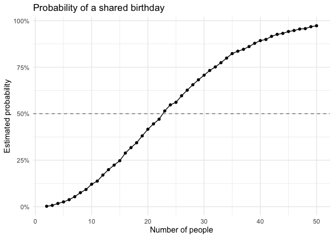

p8105_hw5_cl4946
================

``` r
library(dplyr)
```

    ## 
    ## Attaching package: 'dplyr'

    ## The following objects are masked from 'package:stats':
    ## 
    ##     filter, lag

    ## The following objects are masked from 'package:base':
    ## 
    ##     intersect, setdiff, setequal, union

``` r
library(tidyverse)
```

    ## ── Attaching core tidyverse packages ──────────────────────── tidyverse 2.0.0 ──
    ## ✔ forcats   1.0.1     ✔ readr     2.2.0
    ## ✔ ggplot2   4.0.3     ✔ stringr   1.6.0
    ## ✔ lubridate 1.9.5     ✔ tibble    3.3.1
    ## ✔ purrr     1.2.2     ✔ tidyr     1.3.2

    ## ── Conflicts ────────────────────────────────────────── tidyverse_conflicts() ──
    ## ✖ dplyr::filter() masks stats::filter()
    ## ✖ dplyr::lag()    masks stats::lag()
    ## ℹ Use the conflicted package (<http://conflicted.r-lib.org/>) to force all conflicts to become errors

``` r
library(purrr)
```

# Problem 1

I used simulation of groups of people to estimate the probability that
at least two people share a birthday. Assuming that birthdays are
independent and equal likely.

``` r
has_shared_birthday = function(group_size) {
  birthdays = sample(1:365, size = group_size, replace = TRUE)
  any(duplicated(birthdays))
}
```

``` r
set.seed(8105)

birthday_probabilities =
  expand_grid(
    group_size = 2:50,
    simulation = 1:10000
  ) |>
  mutate(shared_birthday = map_lgl(group_size, has_shared_birthday)) |>
  group_by(group_size) |>
  summarize(
    probability = mean(shared_birthday),
    .groups = "drop"
  )
```

``` r
birthday_probabilities |>
  ggplot(aes(x = group_size, y = probability)) +
  geom_line() +
  geom_point(size = 1.5) +
  geom_hline(yintercept = 0.5, linetype = "dashed", color = "gray50") +
  scale_y_continuous(labels = scales::label_percent()) +
  labs(
    title = "Probability of a shared birthday",
    x = "Number of people",
    y = "Estimated probability"
  ) +
  theme_minimal(base_size = 12)
```

<!-- -->
